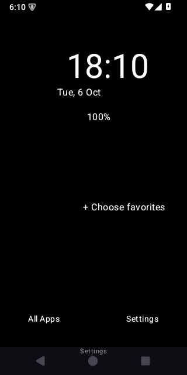
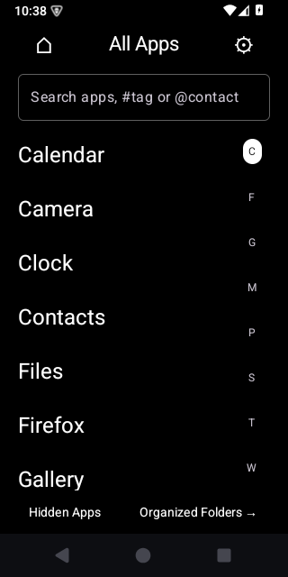
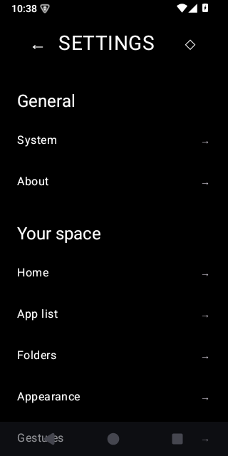

# EmmanueLA


A minimalist Android launcher for intentional phone use. Local settings, deliberate search, organized folders and optional focus rules. This project continues the existing v2.6 application and preserves its identity and data format.

**Version:** 2.6.0-beta · **Android:** 8.0/API26 or newer · **License:** MIT

## What it does

- Independent Home, App List and folders, with an optional Home alphabet and configurable gestures.
- Ranked app/alias search, tags (`#`), permission-based contacts (`@`), keyboard-submitted web searches (`/query`), five local recent web searches, compact protected folder results and opt-in searchable actions. Configured actions require a tap and retain ordinary launch authorization checks.
- Direct held dragging of Home widgets and installed-app icons, independent widget presets and safe JSON style import with preview. Placement is saved on completed drops; cancelled movement is discarded.
- Password/device-protected folders, manual ordering, per-folder RGB/image backgrounds and screen-adaptive custom folder grids, alongside the existing clock/date/battery/usage/weather/location widgets.
- **Live the Moment:** grouped limits, schedules, continuous Strict Block, controlled Breaks, warnings/grace and optional intention prompts. These are self-management tools, not tamper-proof parental controls.
- Optional notification dismissal/digest with schedules, keywords, Strict Block scope and temporary suppression, plus local spam filtering with per-app overrides, allowlists and reviewable reasons. Critical categories, ongoing services and recognized security messages have preservation guards. Android channel settings control quiet delivery; a listener cannot undo an alert already played.

## Honest platform limits

Launcher entry checks and optional accessibility enforcement have different boundaries. Apps can still be opened through other Android surfaces when accessibility enforcement is disabled or restricted. Private Space protects launcher entry points; it does not encrypt or isolate other apps.

Website blocking is **best-effort visible-address matching**, not a VPN. The implementation now handles Firefox's Compose address control as well as traditional browser address fields. Adapter implementation and actual browser/version verification are separate; see the [browser/mode evidence](docs/BROWSER_COMPATIBILITY.md) and [current acceptance evidence](docs/DEVICE_REPAIR_VALIDATION.md). Unsupported or unreadable states produce diagnostics. Selective native Shorts/Reels/feed filtering is unsupported.

## Privacy

No accounts, ads or analytics. Configuration and focus rules stay on the device. Contact search and notification/spam matching run locally; message bodies, intentions and Accessibility-observed browser history are not persisted. The last five explicitly executed web searches are saved locally and can be cleared. Optional weather sends selected coordinates/location queries to Open-Meteo. Android backup is disabled; explicit exports omit nonportable grants and temporary access state. See [permissions and privacy](docs/PRIVACY.md).

## Install and build

For beta testing, open **Actions → Validate EmmanueLA → a successful main-branch run → Artifacts → EmmanueLA-APK**. Extract the ZIP and install **EmmanueLA.apk**. It is the R8-minified, resource-shrunk release APK, signed with a dedicated beta key and checked for signature, non-debuggable status and API35 emulator installation. Both existing validation jobs must pass before signing. No GitHub Release or Google Play publication is created.

The beta signing identity must remain stable for updates. An existing installation signed with a different key cannot be updated in place; export any needed launcher configuration before choosing to uninstall it. Physical-device compatibility is not certified by emulator checks. Maintainer setup and signing boundaries are in [beta APK signing](docs/BETA_APK.md). The separate `EmmanueLA-builds` artifact still contains development/unsigned build outputs.

Open this repository directory in Android Studio, using JDK17 and Android SDK35. The wrapper uses Gradle8.11.1, AGP8.9.2 and Kotlin2.1.20.

```sh
./gradlew clean :app:testDebugUnitTest :app:lintDebug :app:assembleDebug :app:assembleRelease :app:bundleRelease --stacktrace --max-workers=2
./gradlew :app:connectedDebugAndroidTest --stacktrace --max-workers=2
```

On Windows use `gradlew.bat`. Outputs are under `app/build/outputs/`. Select EmmanueLA in Android's default Home settings after installing. Sensitive permissions are optional and requested for the corresponding feature.

## Validation and roadmap

Physical-device observations supersede earlier completion reports. The current repair's per-item status, exact commands, test outcomes, CI results and remaining physical checks are recorded in [device repair validation](docs/DEVICE_REPAIR_VALIDATION.md). The [implementation inventory](docs/DEVICE_REPAIR_IMPLEMENTATION.md) explains the root causes and changed paths; [widget import schema](docs/WIDGET_STYLE_SCHEMA.md), [folder appearance and size](docs/folder-appearance-and-size.md), [notification filtering](docs/NOTIFICATION_FILTERING.md) and [search behavior](docs/SEARCH.md) document operation and limits.

Earlier engineering reports and measurements remain historical records. Compilation, JVM checks and emulator results do not certify physical enforcement, OEM lifecycle behavior, gesture feel, battery performance or document-provider access.

### Release screenshots

Actual API35 emulator captures of the minified release:

| Home | App List | Settings |
|---|---|---|
|  |  |  |

Contributions should preserve the existing design and data. Start with [CONTRIBUTING](CONTRIBUTING.md), use the issue templates for reproducible problems, and read [SECURITY](SECURITY.md). Remaining acceptance requires physical devices/OEMs, biometrics, haptics, battery and high-refresh displays. Earlier delivery notes are preserved in [history](docs/history/README-delivered.md).

Licensed under [MIT](LICENSE). The logo above reproduces the application's existing vector icon.
